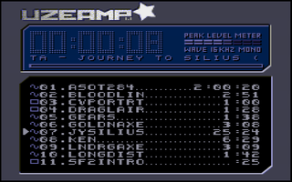
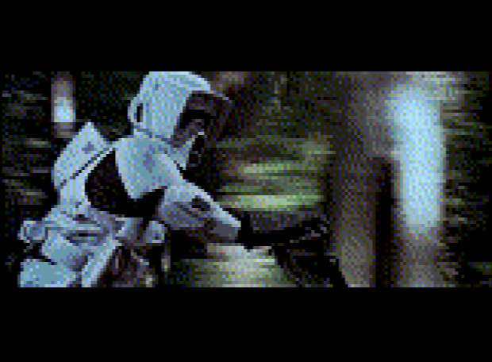
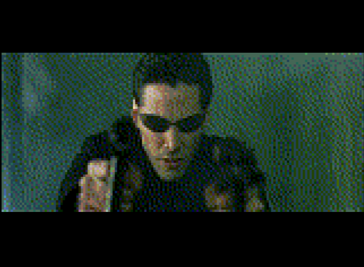

# Uzeamp

A music and movie player for the Uzebox: it streams WAV songs and UZM movies from an SD card,
read with UzeFS (FAT16/FAT32, SD and SDHC cards).



<p>   </p>

Full documentation: **[uzebox.org/wiki/Uzeamp](https://uzebox.org/wiki/Uzeamp)**.
ROMs (UZE and HEX): **[the forum post](https://uzebox.org/forums/viewtopic.php?p=38438#p38438)**.

## Features

- WAV songs: 8-bit unsigned mono at 15.7 kHz (15,734 Hz) or 31.5 kHz (31,468 Hz), with their title
  and artist.
- Movies (.UZM): 160x114 pixels in 254 colours at 24, 25, 30 or 60 fps, with 15.7 kHz sound. Pause
  on a still picture, cue forward and back, step one picture at a time.
- Skins, VU meter, progress bar, the playing file's format, auto-play of the next file.
- Tests the SD card's speed before the first movie; works with the old slow cards of the Uzebox
  kits for songs.
- Up to 118 files, in the card's root directory.

## Controls

| Button | Songs and the list | While a movie plays |
|---|---|---|
| Start | play / pause | pause on a still picture |
| Select | skins | back to the list, the movie paused |
| Up / Down | choose a file | |
| Left / Right (or the shoulders) | fast backward / forward (A: faster) | cue back / forward, 1 s a step (A: 10 s) |
| A / B | | step one picture forward / back |
| Y | auto-play on / off | |

## Songs

Convert with [FFmpeg](https://ffmpeg.org); the file name must be a short 8.3 name:

```
ffmpeg -i input.mp3 -f wav -bitexact -acodec pcm_u8 -ac 1 -ar 15734 -map_metadata -1 -metadata title="Title" -metadata artist="Artist" SONG.WAV
```

For clearer treble, `-ar 31468` (31.5 kHz, twice the size; the file must be in one piece on the card).

## Movies

Convert with **uzm** ([tools/uzm](../../tools/uzm)): one program with FFmpeg's libraries built in.
`make` at the repository's root puts it in `bin/`; `make dist` in `tools/uzm` makes a standalone
`uzm.exe` on Windows.

```
uzm encode input.mp4 MOVIE.UZM --title "Title" --artist "Artist"
uzm encode film.mkv FILM.UZM --letterbox --temporal         # a 24 fps film, smoother colours
uzm encode toon.mp4 TOON.UZM --ivtc                         # a cartoon carried at 60 fps
uzm info MOVIE.UZM                                          # check every sector
```

The rate follows the source (60, 30, 25 or 24 fps; about 70 MB a minute at 60, 28 at 24). A movie
must be in one piece on the card: copy it to a card with enough free space. Movies made for
Uzeamp 1.0 must be converted again. The wiki lists every option, with examples.
`tools/uzm.py` (Python and FFmpeg) makes the same files.

## Building

`make` in `default/` builds `Uzeamp.hex` and `Uzeamp.uze`; the files in `default/uzedisk/` are the
SD card CUzeBox serves with `--sdhost`.
